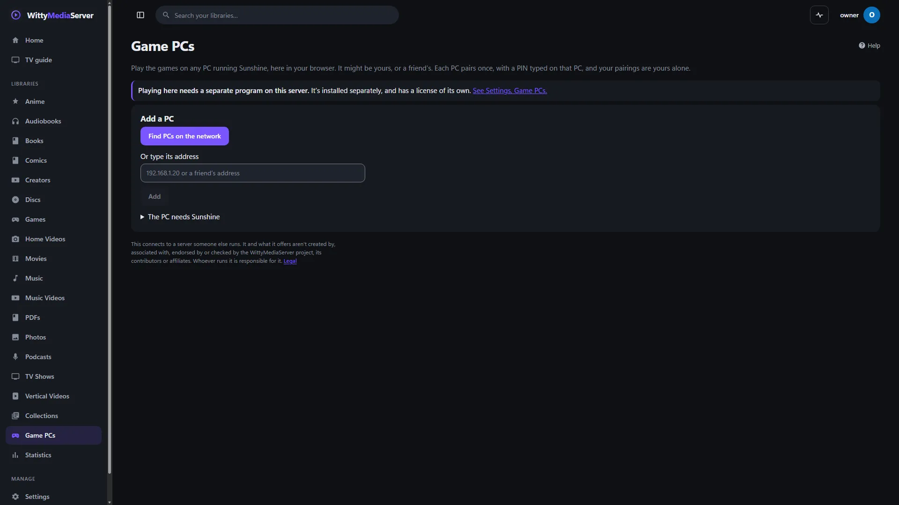
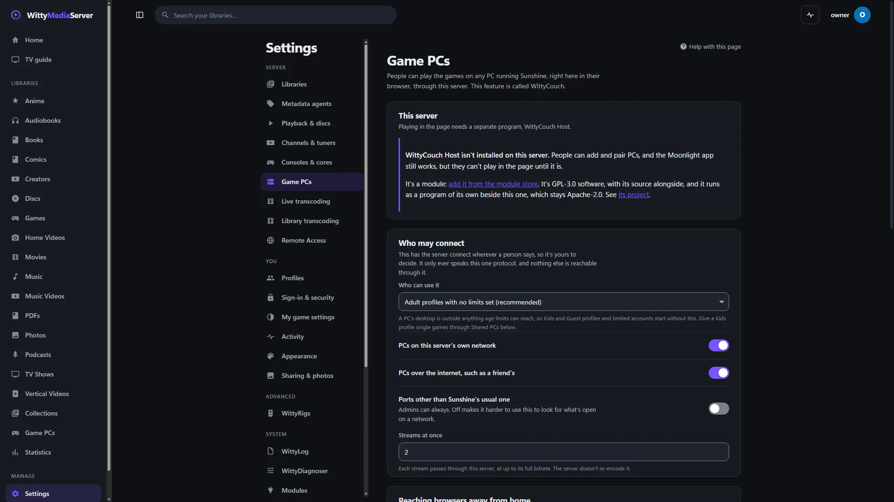

# WittyCouch

Plays the games on any PC running Sunshine, in your browser, through WittyMediaServer. You need it if you, or a friend, have a gaming PC with Sunshine on it.

It isn't part of, or made by, the Moonlight or Sunshine projects.

<!-- pictures -->



<sub>Game PCs in WittyMediaServer, on a server with none added yet.</sub>



<sub>Settings, Game PCs, on a server with none added yet.</sub>

<!-- /pictures -->

## What it does

- **Finds PCs** and pairs with them using a PIN, with the PC's certificate pinned.
- **Lists a PC's games,** and starts, resumes and quits them. It can wake a PC.
- **Plays them in the page** with controllers, keyboard, mouse and touch. Frames travel over WebRTC and aren't decoded or re-encoded on the server.
- **Hands off to the separately installed Moonlight app** on a device that can't play in a page.

Playing needs WittyCouch Host, a separate program. Without it, everything but playing still works. It connects to a PC someone else may run, and what that PC offers isn't provided or checked. No games come with it.

How to use it is in **Help** inside WittyMediaServer: see Game PCs.

## How to get it

An admin adds it from the module store inside WittyMediaServer: **Settings → Modules**, then **Browse the store**, then **Add** beside WittyCouch. That needs WittyMediaServer 0.6.0-alpha or later, and it works with nothing older. The range this version fits is in `module.json`: 0.6.0-alpha through 0.6.x.

Adding it brings WittyCouch Host, which it's built on.

## What it needs

- [WittyCouch Host](https://github.com/wittywilla/WittyCouchHost), which carries the stream.
- A PC running Sunshine, which you set up yourself.
- It asks the server for three permissions: network, running programs, and data.

It's built on pion/webrtc and [WittyModule](https://github.com/wittywilla/WittyModule), built in. It's written in Go with no cgo, and the player in `web/` is React.

## Platforms

A real browser, Edge on Windows, has played a real stream from a real Sunshine. Real games on real gaming PCs haven't been tried yet.

A program is built for each system below, and the server uses the right one.

| System | Where it stands |
|---|---|
| Linux (x64, arm64, 32-bit ARM, x86) | Its tests pass on x64, and it installs on a test server with its host. The other CPUs are only built |
| Windows (x64, arm64) | Built. This version hasn't been run on Windows since it became its own program |
| macOS (Intel, Apple silicon) | Built by the release tool. It has not been run on a real Mac |
| FreeBSD (amd64, arm64) | Cross-compiled only. It has not been run |

On macOS and FreeBSD the server has no sandbox for a module's helper: it gets a small environment and a soft memory limit, and nothing more.

WittyCouch Host has no FreeBSD build, so on FreeBSD the store says so in place of **Add**. It also has none for 32-bit Linux or Windows on arm64.

## Building and testing

You need Go 1.26 or newer. In a worktree, first run the copy of `dev-modules.mjs` kept above the repositories (`node D:/projects/dev-modules.mjs` on the development machine). It writes a `go.work` that git ignores, so the checkout builds against the repositories beside it. Never run `go work use`.

```bash
go vet ./...
```

```bash
go test ./... -count=1
```

```bash
go run github.com/wittywilla/wittymodule/cmd/wittymodule check .
```

The last one checks the manifest. On the same tool, `pack -targets linux/amd64 -out release .` builds a release for one system. CI also builds for every system.

```bash
npm install
```

```bash
npm run build:bundle
```

Automated tests run `gamestream` against the stand-in for Sunshine in `gamestream/fake`, and `relay` over real WebRTC with a stand-in for the host program. To test against a real Sunshine:

```bash
WITTYCOUCH_REAL=127.0.0.1 WITTYCOUCH_USER=name WITTYCOUCH_PASS=secret go test ./gamestream -run TestRealSunshine -v
```

```bash
WITTYCOUCH_REAL=127.0.0.1 WITTYCOUCH_USER=name WITTYCOUCH_PASS=secret WITTYCOUCH_HOST=/path/to/wittycouch-host go test ./relay -run TestRealStream -v
```

| Part | What for |
|---|---|
| `gamestream` | A PC's client API: `Browse`, `Rig.Pair`, `Apps`, `AppImage`, `Launch`, `Resume`, `Quit`, `Wake`, and the rules on which addresses may be reached |
| `relay` | Runs WittyCouch Host and carries its frames to a browser over WebRTC, and input back |
| `web` | The player |
| `plan.go` | What each device can do when it can't play in a page |

`facade.json` lists what the server calls in this module. Changing it means rerunning the generator in WittyModule's `kit/facade`, which writes the stubs on both sides.

## Licence

GNU Affero General Public License v3.0 (or later): see [LICENSE](LICENSE) and [NOTICE](NOTICE). If you redistribute it or build on it, please keep the NOTICE attribution. It contains no Moonlight or Sunshine code. Linked in: pion/webrtc and its dependencies (MIT).

To stream, it starts WittyCouch Host, a separate program under the AGPL-3.0-or-later with Moonlight-derived parts under the GPL-3.0, built on [moonlight-common-c](https://github.com/moonlight-stream/moonlight-common-c). The two only exchange the messages in that program's `PROTOCOL.md`, over pipes. Moonlight and Sunshine are GPL-3.0 programs. Each release archive carries a `THIRD-PARTY-NOTICES.txt` for what its programs link.

## Legal

WittyCouch is an independent open-source project. It isn't associated with, sponsored by or endorsed by
the Moonlight or Sunshine projects, NVIDIA, or any game publisher. It connects to a PC someone else may
run, and what that PC offers isn't provided or checked by this project. No games come with it. Any
third-party names here only describe what it works with, and belong to their owners. It's provided
“as is”, with no warranty; see [LICENSE](LICENSE). Local law applies to how you use it. This isn't legal
advice.

<!-- module-kit -->
## Releasing

A version tag builds a program for every platform, signs the checksum list, and publishes a release that servers can install.

Versions move in small steps as work lands. `go run github.com/wittywilla/wittymodule/cmd/wittymodule@v0.3.0 bump .` raises it
everywhere it is written (add `-part minor` for a bigger step). A bump isn't a release: nothing is
tagged or published until you tag it. CI fails when code changed since the last tag and the version
didn't, because tags never move.

To release:

1. Check that `version` in `module.json` is the one to publish, with the bump committed.
2. Tag that commit and push the tag: `git tag vX.Y.Z`, then `git push origin vX.Y.Z`. A tag with a
   suffix, such as `v1.2.0-beta`, is published as a prerelease.
3. Watch the *Actions* tab. The signing step uses the `WMS_SIGNING_KEY` secret of the `release` environment, and nothing is published without it.

To take a version back, run the *withdraw* workflow from the *Actions* tab. It adds the version to a signed list on the release tagged `withdrawals`, which servers read.

Licensed under AGPL-3.0-or-later: see [LICENSE](LICENSE) and [NOTICE](NOTICE).
<!-- /module-kit -->
